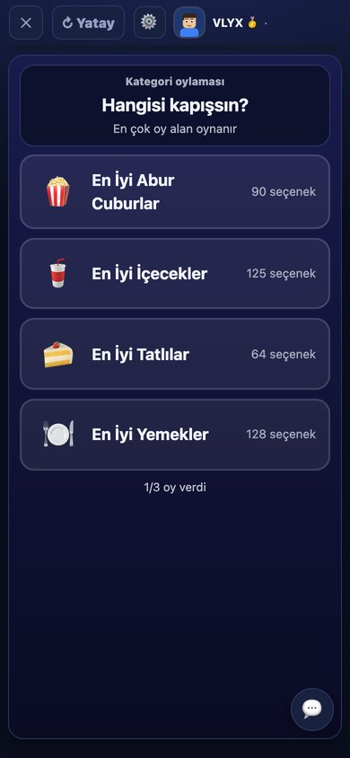
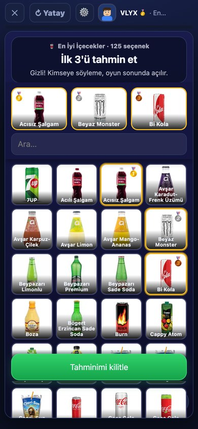
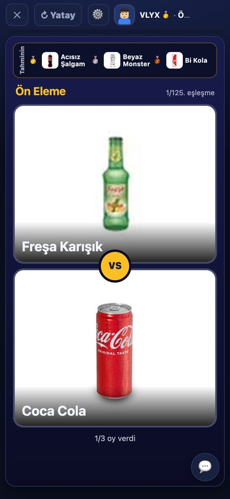
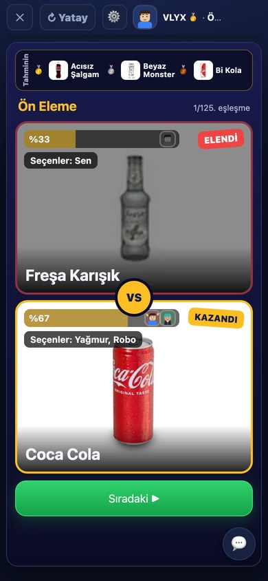
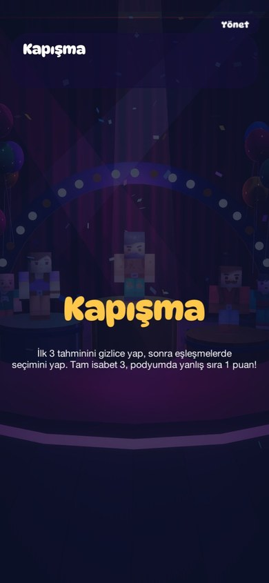
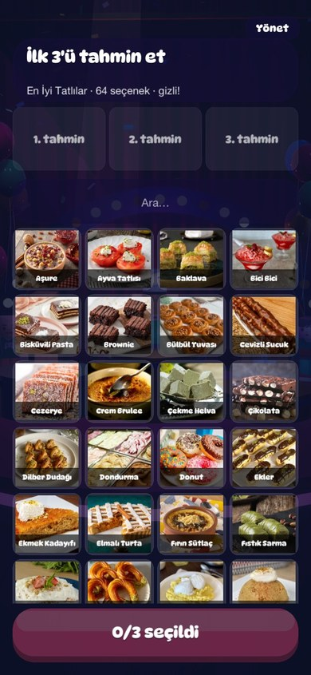
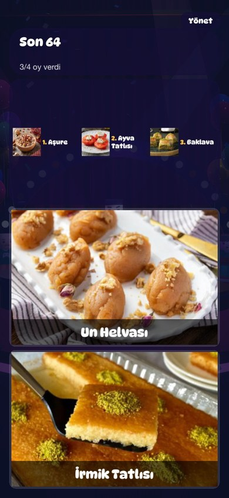
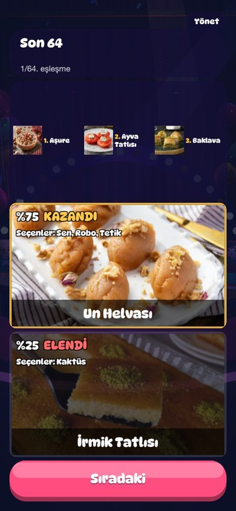

# Parti Ligi (Party League) — mini oyun partisi

Telefonda (Safari → Ana Ekrana Ekle) oynanan, oda koduyla arkadaşlarla ya da botlarla oynanan parti oyunu.

**Oyun listesi:** web sürümünde 21 oyunun hepsi var; iPhone uygulamasında (Unity) 15 oyun hazır, 5 gerçek zamanlı oyun taşınıyor.

| # | Oyun | Tür | Web | iPhone | Nasıl |
|---|---|---|:---:|:---:|---|
| 1 | 🪨 **Sapan Arenası** | tur tabanlı | ✅ | ✅ | Gizlice yerleş, nişan al; vurulan itilir. Adadan düşen elenir, alan her tur küçülür. |
| 2 | 💣 **Bomba Ustası** | gerçek zamanlı | ✅ | ⏳ henüz yok | Labirentte bomba bırak, kutulardan güç topla, rakipleri patlat. |
| 3 | 🎨 **Kulaktan Kulağa** | tur tabanlı | ✅ | ✅ | Yaz → çiz → tahmin et zinciri; sonunda albüm ve oylama. |
| 4 | 🖍️ **Ne Çizdim?** | tur tabanlı | ✅ | ✅ | Biri kelimeyi canlı çizer, diğerleri tahmin eder; ilk bilen en çok puanı alır. |
| 5 | 🧠 **Bil Bakalım** | tur tabanlı | ✅ | ✅ | Oylamayla kategori, 2 joker (yarı yarıya, çift cevap), 8 kategori × 100 soru. |
| 6 | 🗿 **Keski Düellosu** | tur tabanlı | ✅ | ✅ | Kısa süre gösterilen taş küpü ezberden aynı şekilde yont. |
| 7 | 🧨 **Bombayı Çöz** | takım | ✅ | ✅ | Biri bombayı, biri kılavuzu görür; konuşarak kablo, düğme ve şifreyi çözün. |
| 8 | 🏃 **Kör Koşu** | takım, gerçek zamanlı | ✅ | ⏳ henüz yok | Koşucu sisin içinde, yönlendirici yolu anlatır. |
| 9 | 🪢 **Halat Çekme** | takım, gerçek zamanlı | ✅ | ✅ | ÇEK düğmesine hızlı bas, karşı takımı çamura düşür. |
| 10 | 🛶 **Kayık Kafilesi** | takım, gerçek zamanlı | ✅ | ⏳ henüz yok | Ortak kayıkta birlikte kürek çekip nehri ilk bitiren kazanır. |
| 11 | 🏎️ **Pist Canavarı** | gerçek zamanlı | ✅ | ⏳ henüz yok | Araba yarışı: direksiyon + gaz/fren, 3 tur. |
| 12 | 🐾 **Pati Koşusu** | gerçek zamanlı | ✅ | ⏳ henüz yok | Hayvanlarla yandan koşu yarışı, zıpla/kay/özel güç. |
| 13 | 🎤 **Ortak Şarkı** | tur tabanlı | ✅ | — (kararla taşınmıyor) | Herkes dize yazar, oyun ortak bir şarkı kurup çalar, oylanır. |
| 14 | 🧩 **Ne Kadar Tanıyorsun?** | takım | ✅ | ✅ | Kendin hakkında soruları cevapla, takım arkadaşın seni tahmin etsin. |
| 15 | 🏀 **Pota Atışı** | tur tabanlı | ✅ | ✅ | 45 sn çek-bırak basket; ardışık sayılar katlanır. |
| 16 | 🎧 **Şarkıyı Tahmin Et** | takım | ✅ | ✅ | Şarkının ilk saniyelerinden adını bul; takım ortak karar verir. |
| 17 | ⏱️ **Kayıp Saniye** | tur tabanlı | ✅ | ✅ | Kronometre 3. saniyede kaybolur; hedef süreyi içinden sayıp durdur. |
| 18 | 🐑 **Sürü** | tur tabanlı | ✅ | ✅ | Kalabalıkla aynı cevabı ver, tek kalan kara koyun olur. |
| 19 | 🎯 **Ayar** | tur tabanlı | ✅ | ✅ | Anlatıcının ipucuyla kadrandaki gizli noktayı bul. |
| 20 | ☕ **Telve** | tur tabanlı | ✅ | ✅ | Falcı bir kartı yorumlar, herkes kendi kartını karıştırır; doğruyu bul. |
| 21 | 🥇 **Kapışma** | tur tabanlı | ✅ | ✅ | Gizli ilk 3 tahmini, sonra seçenekler ikişer kapışır; tam isabet +3. [Ekranlar](docs/kapisma/README.md) |
| — | 🏆 **Turnuva** | — | ✅ | ✅ | Lobide seçilen oyunlar sırayla. 1. → 3, 2. → 2, 3. → 1 puan. Aralarda skor grafiği, sonunda podyum. |

### 🥇 Kapışma: ekranlar

Herkes ilk 3 tahminini gizlice yapar, sonra seçenekler ikişer ikişer kapışır. Podyum açılınca tahminler puanlanır.
Ayrıntı: [docs/kapisma](docs/kapisma/README.md).

| Web: kategori | Web: tahmin | Web: eşleşme | Web: sonuç |
|:---:|:---:|:---:|:---:|
|  |  |  |  |

| Mobil: başlık | Mobil: tahmin | Mobil: eşleşme | Mobil: sonuç |
|:---:|:---:|:---:|:---:|
|  |  |  |  |

**Gerçek zamanlı oyunlar:** Netlify WebSocket desteklemediği için telefonlar WebRTC ile doğrudan bağlanır
(bağlantı kurulumu mevcut `/api` üzerinden). Oyunu oda sahibinin telefonu yönetir (30 Hz simülasyon, 15 Hz
görüntü), diğerleri kumanda gönderir. Bazı mobil operatör ağlarında doğrudan bağlantı kurulamayabilir;
o oyuncunun yerine bot oynar. Oda sahibi kaybolursa sunucu oyunu son bilinen sıralamayla bitirir.

**Takım oyunları** (🧨 🏃 🪢 🛶) oyuncuları eşit takımlara böler; sayı tutmazsa oyun süresince "Yedek" botlar eklenir (puan almazlar). Başlamadan önce **takımlar ekranı** açılır (kim hangi takımda, takım renkleriyle); herkes **Tamam** deyince oyun başlar. Tamam demeyen biri en fazla 40 sn beklenir; botlar ve telefonu kilitli oyuncular beklenmez. Oyun sırasında üst çubukta kendi takımın ve takım arkadaşların görünür.

Lobide oda sahibi turnuvayı ya da tek bir oyunu seçer. Oyun bitince herkes **Tekrar oyna** diyebilir.
**👕 Karakterim** ekranında (ana ekrandaki avatara dokununca da açılır) cinsiyet, ten, göz, sakal, saç, kıyafet ve her parçanın rengi ayrı ayrı,
şapka/gözlük/aksesuar seçilir (3D önizleme; döndürme açılıp kapanır, emote butonları). Avatarlar her yerde canlı: ara sıra göz kırpar,
el sallar, kafa kaşır, şaşırır, sevinir, zıplar (portrelerde ifade kareleri, 3D'de emote animasyonları).
💬 butonuyla hazır laf/emoji gönderilir.

## Yapı

```
public/
  index.html, style.css, ui.css, app.js   Uygulama kabuğu (ekranlar, ağ, panel, mesajlar)
  game-core.js                      Oda + turnuva akışı (sunucu ve tarayıcı ortak)
  games/                            Oyun kuralları (sunucu ve tarayıcı ortak)
    lazer.js  bomba.js  yaris.js  cizim.js  neciz.js  kelimeler.js  bilgi.js  keski.js  bombaci.js  korkosu.js  halat.js  kayik.js  avatar.js  util.js
  client/                           Çizim ve kontroller
    lazer.js (2D + 3D FPS)  bomba.js  yaris.js  cizim.js  neciz.js  bilgi.js  keski.js (3D)  bombaci.js  kor.js  halat.js  kayik.js
    rt.js (gerçek zamanlı çerçeve)  ui.js (skor/podyum)  custom.js  avatar2d.js  avatar3d.js
  vendor/three.min.js               three.js (yalnızca FPS ve karakter ekranında yüklenir)
netlify/functions/api.mjs           Tek API ucu: /api (oda verisi Netlify Blobs'ta)
dev-server.mjs                      Netlify'sız yerel test sunucusu
test/run.mjs + test/*.test.mjs      Kural testleri (npm test hepsini çalıştırır)
```

Netlify WebSocket desteklemediği için istemciler saniyede bir `/api`'ye soruyor; oyunlar bu yüzden
"herkes gizlice seçer → aynı anda oynanır" turlarıyla tasarlandı. Eşzamanlı hamleler Blobs'un koşullu
yazmasıyla (etag) güvenle birleşiyor. Botlar ve telefonu kilitli (12 sn sinyal yok) oyuncular beklenmez.

## Komutlar

```bash
npm install            # bağımlılıklar (kurulum betikleri .npmrc ile kapalı)
npm run dev            # http://localhost:8888
npm test               # kural testleri
npx netlify deploy --prod   # yayınla
npm run build:three    # three.js sürümü değişirse vendor dosyasını yeniden üret
```

Yerelde `http://localhost:8888/?cizim` adresi test modudur: sayfa görünmezken de çizer ve tuval
görüntülerini geçici klasöre kaydedebilir (yalnızca yerel test sunucusunda çalışır).

## Şirket bilgisayarı notu

Güvenlik yazılımı kullanıcı klasöründeki exe'leri (ör. `esbuild.exe`) engelliyor. Bu yüzden `.npmrc` kurulum
betiklerini kapatıyor, `package.json`'daki `overrides` esbuild'i exe gerektirmeyen `esbuild-wasm` ile değiştiriyor.
Global `npm install -g netlify-cli` bu makinede çalışmaz; her zaman projedeki `npx netlify` komutunu kullan.
