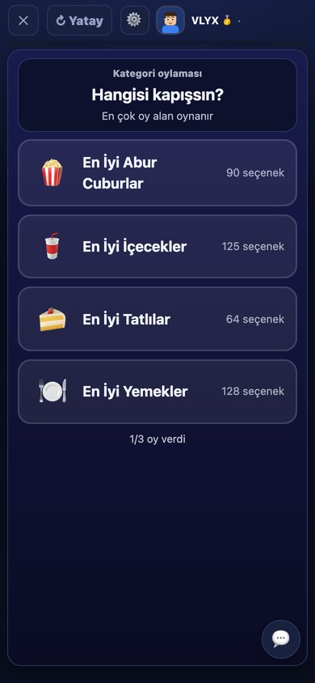
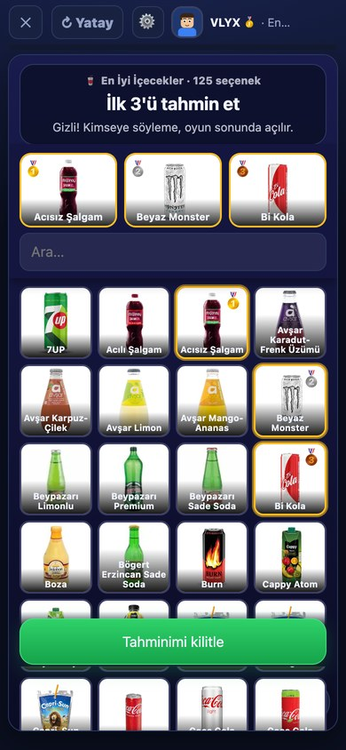
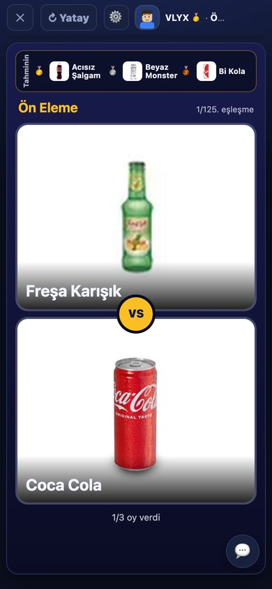
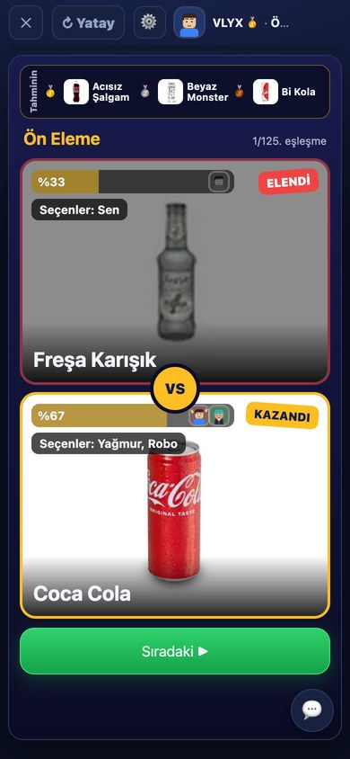
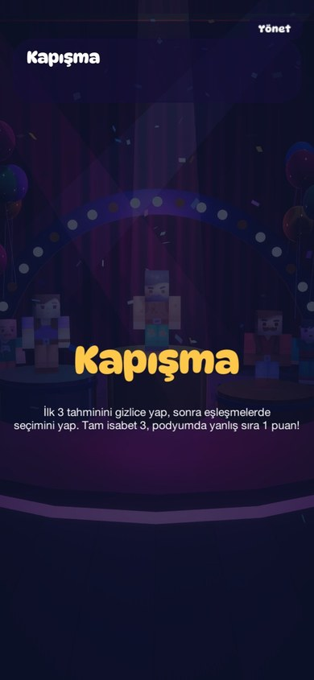
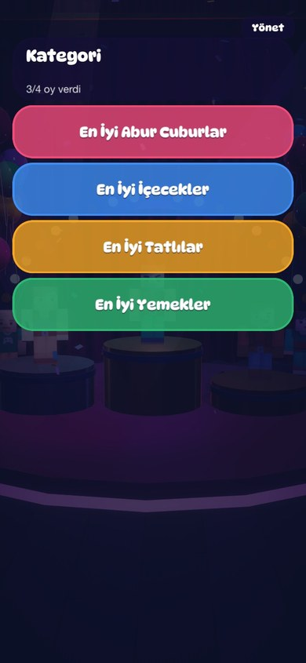
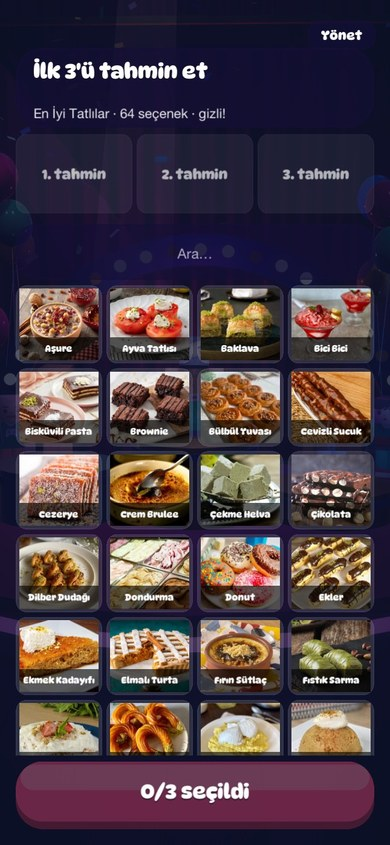
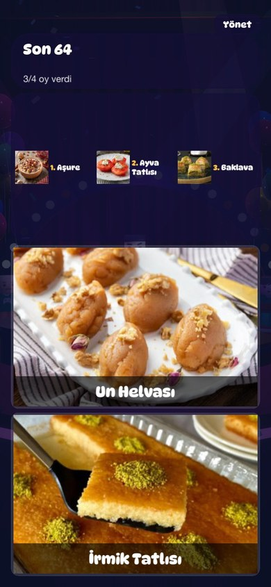
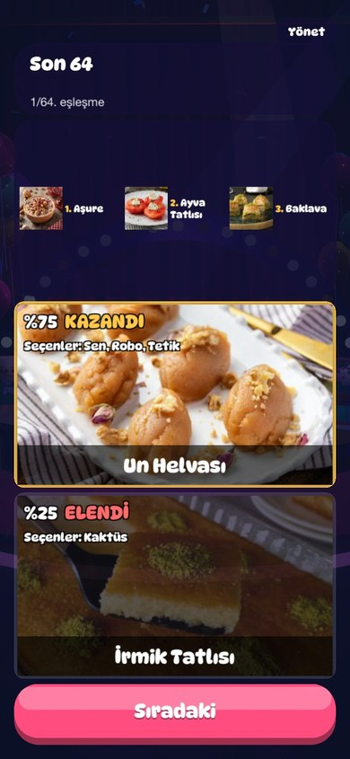

# 🥇 Kapışma

Eleme eşleşmeli tercih oyunu. Herkes oyun başında **ilk 3 tahminini** gizlice yapar; sonra kategorideki
seçenekler ikişer ikişer kapışır. Her eşleşmede oda oy verir, çoğunluğun seçtiği tura geçer. Podyum belli
olunca tahminler açılır.

## Ekranlar

### Web (tarayıcı / ana ekran uygulaması)

| Kategori oylaması | İlk 3 tahmin | Eşleşme |
|:---:|:---:|:---:|
|  |  |  |

| Sonuç: KAZANDI / ELENDİ |
|:---:|
|  |

### Mobil (iPhone uygulaması, Unity)

| Başlık | Kategori | İlk 3 tahmin |
|:---:|:---:|:---:|
|  |  |  |

| Eşleşme | Sonuç |
|:---:|:---:|
|  |  |

## Nasıl oynanır

1. **Kategori:** Oda sahibinin açtığı kategoriler arasından en çok oy alan oynanır (beraberlikte kura).
2. **Tahmin:** İlk, ikinci ve üçüncü sıra için kategorideki seçeneklerden seç. Tahminler gizlidir; sürükleyerek
   arama kutusundan da bulabilirsin. Kilitlemeden önce değiştirebilirsin.
3. **Eşleşmeler:** İki seçenek karşılaşır. Herkes birini seçince sonuç açılır: kazanan **KAZANDI**, kaybeden
   **ELENDİ** olur. Altta seçenlerin isimleri yazar. Oda sahibi **Sıradaki** deyince geçilir.
4. **Podyum:** Tahminler açılır.
   - Doğru sırada tam isabet: **+3**
   - Podyumda ama yanlış sırada: **+1**

Süre sınırı yok: herkes seçince ilerler.

## Kurallar (kısaca)

- Kategorideki **bütün seçenekler** turnuvaya girer (yemek 128, içecek 125, abur cubur 90, tatlı 64).
- Seçenek sayısı 2'nin kuvveti değilse önce **ön eleme** oynanır; fazlalık kadar maç yapılır.
- Maç sayısı = seçenek sayısı. Yani yemek kategorisi 128 eşleşme sürer.
- Yarı final kaybedenleri **üçüncülük maçı** yapar; final kazananı 1., kaybedeni 2. olur.

## Kaynak

- Kurallar: [`public/games/kapisma.js`](../../public/games/kapisma.js)
- Web istemcisi: [`public/client/kapisma.js`](../../public/client/kapisma.js)
- Unity istemcisi: [`unity/Assets/Scripts/Oyunlar/Kapisma/KapismaEkrani.cs`](../../unity/Assets/Scripts/Oyunlar/Kapisma/KapismaEkrani.cs)
- Testler: [`test/kapisma.test.mjs`](../../test/kapisma.test.mjs)
- Yeni kategori: `scripts/kapisma/<id>.tsv` → `python -I scripts/kapisma-uret.py`
